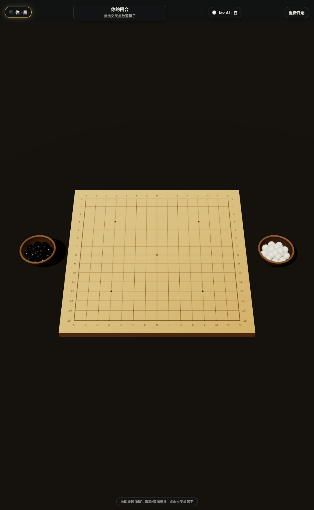
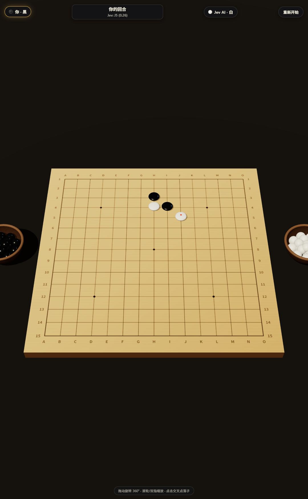
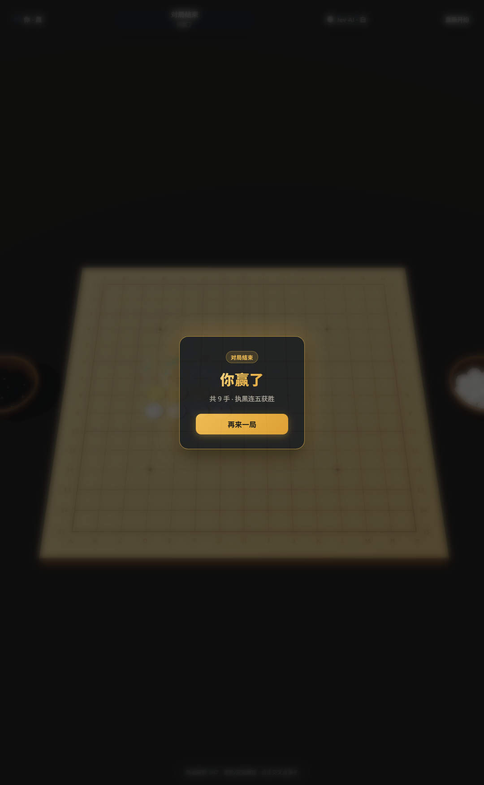
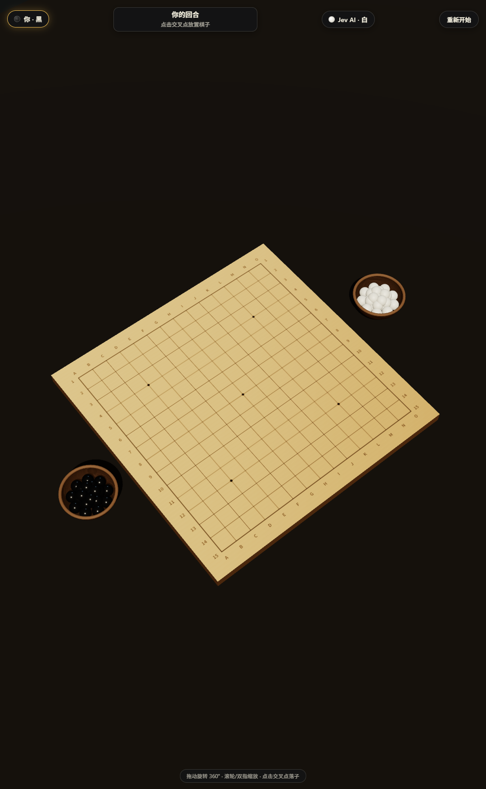
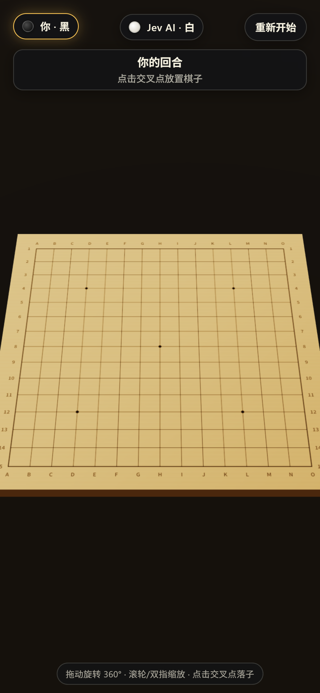

# Gomoku × Jev AI 🎯

**五子棋人机对战 — Three.js 3D 棋盘 × Jev 语言模型应手**

你执黑，AI（[Jev](https://www.typesafe.ai) `jev-latest`）执白。每一手 AI 都由本地启发式生成 ≤10 个带战术标注的候选点（连五 / 堵活四 / 造活三……），再交给 Jev 从中选出最优一步——一个语言模型真正「下棋」的完整示例。



## ✨ 特性

- 🎮 **完整对局**：15×15 标准五子棋规则，连五获胜，满盘和棋
- 🧠 **两层 AI**：启发式候选生成（战术分级打分）+ Jev choice 题型选点，状态栏实时显示落点与置信度（如 `Jev: H7 (0.29)`）
- 🏺 **动态棋罐**：棋盘左右各一只木碗，落子时棋子从罐内沿弧线飞出，存量随对局递减，重开自动补满
- 📷 **360° 视角**：拖动旋转、滚轮/双指缩放（OrbitControls + 阻尼），竖屏手机自动适配相机距离
- 📱 **移动端可玩**：单指点子、单指旋转、双指捏合，触屏全面适配
- 🎉 **胜负特效**：五连子金色发光脉冲、彩色粒子喷发、相机震动、全屏闪光、差异化结算面板

| 对局中 | 终局特效 | 斜视角 | 手机端 |
|---|---|---|---|
|  |  |  |  |

## 🚀 快速开始

```bash
git clone https://github.com/fanweiya/gomoku-jev.git
cd gomoku-jev
npm install
```

配置你的 Jev API key（在 [console.typesafe.ai](https://console.typesafe.ai) 创建，或替换为你自己的兼容端点）：

```bash
echo "JEV_API_KEY=你的key" > .env.local
```

启动：

```bash
npm run dev        # http://127.0.0.1:5188
```

> key 只在 Vite 服务端代理中使用，浏览器拿不到；`.env.local` 已在 `.gitignore` 内。

## 🧩 工作原理

```
浏览器 (Three.js)                Vite dev server               TypeSafe API
┌──────────────────┐   POST /api/jev   ┌──────────────┐   Bearer   ┌──────────────┐
│ 落子 → 启发式候选 │ ───────────────→ │ 代理插件注入  │ ────────→  │  jev-latest  │
│ ≤10 个候选点      │ ←─────────────── │ JEV_API_KEY  │ ←────────  │  choice 题型 │
└──────────────────┘  choice+confidence └──────────────┘  JSON      └──────────────┘
```

1. **候选生成**（`src/game/GomokuCore.ts`）：只考虑已有棋子切比雪夫距离 2 格内的空点，按战术量级打分——自己连五 > 堵对方连五 > 活四 > 冲四/双杀 > 活三……每个候选带一句英文战术描述
2. **AI 选点**（`src/game/JevClient.ts`）：候选作为 `choice` 题型的 criteria 发给 Jev，附盘面 ASCII（`X` 黑 `O` 白 `.` 空），返回落点 key + confidence + probabilities
3. **服务端代理**（`vite.config.ts` 插件）：dev/preview 均内置，`/api/jev` 转发上游；key 缺失回 500，上游故障/超时回 502
4. **降级保障**：请求失败或超时（8s）自动用启发式首选落子，游戏永不卡死

## 📁 项目结构

```
src/
├── game/
│   ├── GomokuCore.ts    # 纯规则：胜负判定、坐标编解码、候选生成（零依赖）
│   ├── JevClient.ts     # AI 接入：请求构造、响应解析、超时降级
│   └── Game.ts          # 对局状态机、OrbitControls、射线拾取、相机震动
├── entities/
│   └── BoardView.ts     # 棋盘/棋子/棋罐渲染、飞行动画、粒子、胜利高亮
├── systems/
│   └── Hud.ts           # 回合状态、AI 思考计时、终局面板
└── core/                # Renderer / Loop 脚手架
```

## 🛠️ 技术栈

TypeScript · Vite · Three.js (`OrbitControls` / `Raycaster` / 程序化 Canvas 纹理) · Web 标准事件（Pointer/Touch）

## 📜 License

MIT
