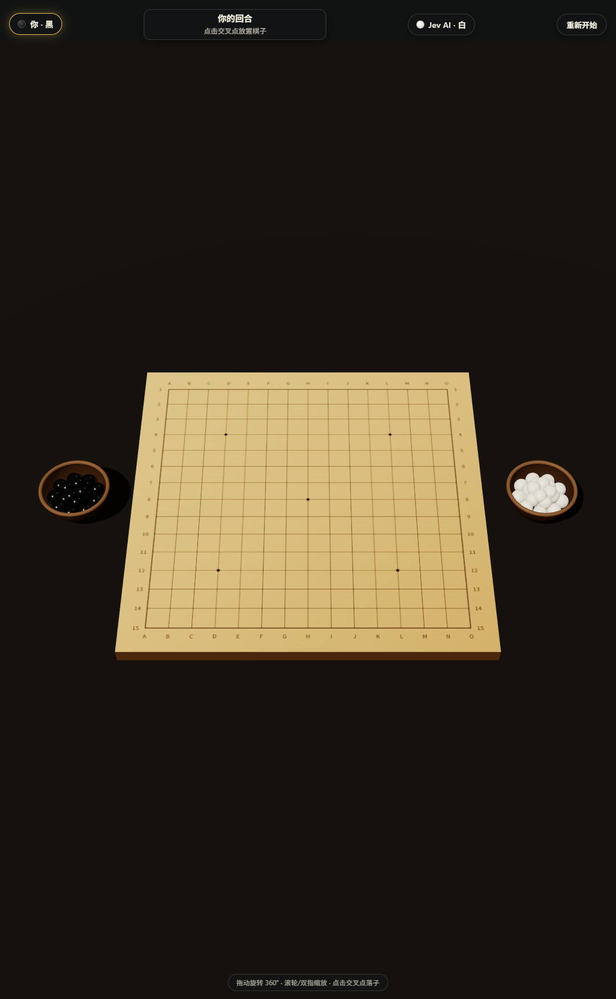
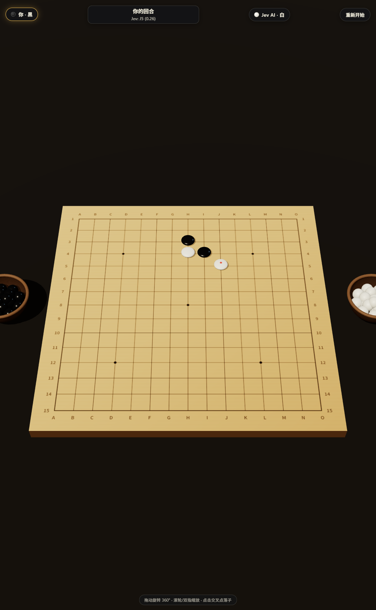
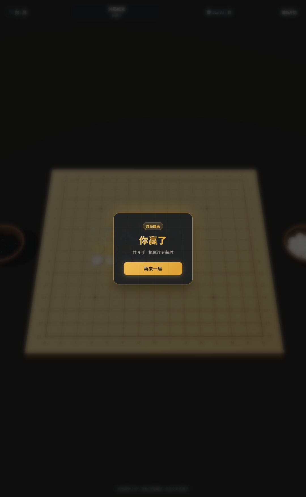
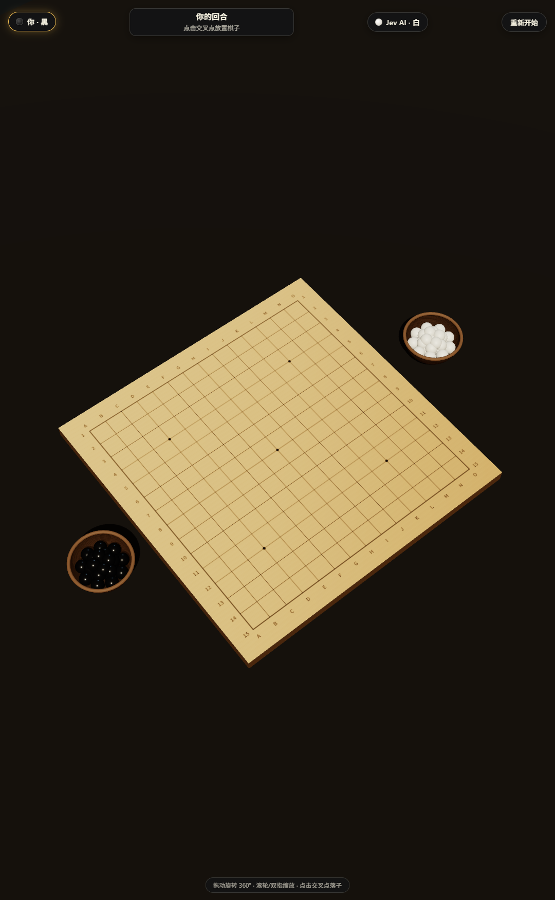
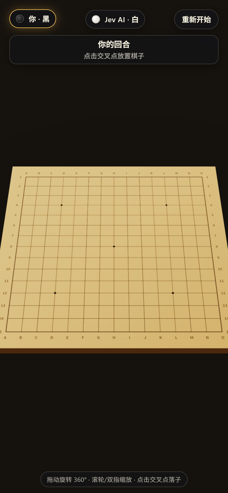

# Gomoku × Jev AI 🎯

**五子棋人机对战 — Three.js 3D 棋盘 × Jev 语言模型应手**

> 🌐 **在线体验 (Live Demo)**: [https://gomoku-jev.pages.dev](https://gomoku-jev.pages.dev)

你执黑棋，AI（[Jev](https://www.typesafe.ai) 等模型）执白棋。每一手 AI 都由本地启发式算法生成 ≤10 个带有战术标注的候选点（连五、堵活四、造活三等），再交由语言模型从中选出最佳的一步——展示语言模型参与棋局博弈的完整范例。



## ✨ 特性

- 🌐 **在线即玩**：已部署至 Cloudflare Pages，打开页面即可对弈；AI 密钥由玩家在设置中填写并保存在浏览器本地，未填写时使用本地启发式算法兜底。
- ⚙️ **多服务通道支持**：内置主流通道预设，支持在界面中直接切换各通道、直达官网申请获取 API Key 并输入自己的密钥进行对弈：
  1. **SubQ (System One)**：接口 `https://api.subq.ai/v1/systemone`，默认模型 `subq-snap-1.2`（官网：[https://subq.ai](https://subq.ai)）
  2. **TypeSafe Jev (官方原版通道)**：接口 `https://api.typesafe.ai/v1/systemone`，默认模型 `jev-preview`，支持专用请求头（控制台：[https://console.typesafe.ai](https://console.typesafe.ai)）
  3. **Codiv OpenJev (开源权重通道)**：接口 `https://api.codiv.ai/v1/systemone`，默认模型 `openjev-latest`，自动附加浏览器 User-Agent（官网：[https://codiv.ai](https://codiv.ai)）
  4. **Cloudflare Workers AI Clef (边缘计算兜底)**：接口 `https://api.cloudflare.com/...`，默认模型 `clef-flash`（控制台：[Cloudflare Dashboard](https://dash.cloudflare.com)）
  5. **MeraGPT**：接口 `https://meragpt.com/v1/systemone`，默认模型 `meragpt-latest`（官网：[https://meragpt.com](https://meragpt.com)）
  6. **Nace AI**：接口 `https://console.nace.ai/v1/systemone`，默认模型 `nace-latest`（控制台：[https://console.nace.ai](https://console.nace.ai)）
  7. **自定义通道 (Custom)**：可自主配置任意兼容接口、模型名称与请求密钥
- 🧪 **连接测试**：设置界面提供一键「测试连接」功能，实时验证接口连通性与模型可用状态。
- 🔒 **本地私密存储**：玩家填写的配置与密钥仅保存在当前浏览器的本地存储中。服务端仅在可选配置了环境变量 `CF_CLEF_API_KEY` 时持有一份密钥，且代理只允许将它发往 `api.cloudflare.com`（Cloudflare Workers AI Clef 通道），不会转发到其他上游。
- 🎮 **完整对局**：15×15 标准五子棋规则，连五获胜，满盘和棋。
- 🧠 **双层判定**：启发式算法生成候选位置（分级打分）+ 模型选择最佳点，状态栏实时显示下子位置与置信度。
- 🏺 **动态棋罐**：棋盘左右各一只木碗，下子时棋子从罐内沿弧线飞出，存量随对局递减，重开自动补满。
- 📷 **360° 视角**：拖动旋转、滚轮/双指缩放（OrbitControls + 阻尼效果），针对移动设备自动适配观察距离。
- 📱 **移动端适配**：支持单指点选、拖动旋转、双指缩放，触控屏幕全面兼容。
- 🎉 **胜负特效**：五连子高亮脉冲、彩色粒子迸发、震屏抖动、闪光效果与结算面板。

| 对局中 | 终局特效 | 斜视角 | 手机端 |
|---|---|---|---|
|  |  |  |  |

## 🚀 快速开始

```bash
git clone https://github.com/fanweiya/gomoku-jev.git
cd gomoku-jev
bun install
```

启动本地开发服务：

```bash
bun run dev        # http://127.0.0.1:5188
```

打开浏览器访问后，点击右上角「⚙ 设置」按钮，选择您拥有的通道或输入您的 API Key 即可开始对弈；若未填写密钥，系统将自动使用本地启发式算法进行下子对弈。

## 🚢 部署到 Cloudflare Pages

Windows 下直接运行 `deploy.ps1`：脚本从 WSL `~/.hermes/.env` 读取 `CLOUDFLARE_API_TOKEN` 与 `CLOUDFLARE_ACCOUNT_ID`，执行 `npm run build` 并通过 `wrangler pages deploy` 发布到 `gomoku-jev` 项目。也可以手动执行：

```bash
npm run build
npx wrangler pages deploy dist --project-name gomoku-jev
```

### 可选的服务端密钥

`/api/jev` 代理默认要求客户端在 `x-jev-api-key` 请求头中自带上游密钥，服务端不保留通用密钥。唯一例外是 Cloudflare Workers AI Clef 通道：当客户端未提供密钥时，代理回退到 Pages 项目的环境变量 `CF_CLEF_API_KEY`，且该变量只允许发往 `api.cloudflare.com`。

- 在 Cloudflare Pages 项目 **Settings → Variables and Secrets** 中添加 `CF_CLEF_API_KEY`（Cloudflare API Token，权限要求：Workers AI 只读/推理权限即可）。
- 本地开发时在项目根目录 `.env` 中写入同名变量，Vite 开发代理会自动加载。

## 🧩 工作原理

```
浏览器 (Three.js 界面)               Cloudflare Pages / Vite 代理             上游 AI 模型接口
┌──────────────────────┐   POST /api/jev   ┌──────────────────────┐   Bearer   ┌──────────────┐
│ 下子 → 启发式候选点   │ ───────────────→ │ 代理转发客户端请求头   │ ────────→  │  Jev / Clef  │
│ ≤10 个候选步骤       │ ←─────────────── │ (x-jev-endpoint/key) ├ ←────────  │  choice 题型 │
└──────────────────────┘  choice+confidence └──────────────────────┘  JSON      └──────────────┘
```

1. **候选位置生成**（`src/game/GomokuCore.ts`）：考量已有棋子切比雪夫距离 2 格内的空位，按战术量级打分（自身连五 > 封堵对方连五 > 活四 > 冲四/双杀 > 活三等），每个候选附带战术描述。
2. **AI 选择位置**（`src/game/JevClient.ts`）：将候选列表作为 criteria 提交给所选模型，附带盘面状态，返回选定的位置、置信度以及概率分布。
3. **安全代理转发**（`functions/api/jev.ts` 与 `vite.config.ts`）：统一由后端代理转发至所选上游接口，避免跨域阻隔。代理仅允许转发到预设通道的上游地址白名单内的 HTTPS 地址；除 Cloudflare Clef 通道外要求客户端自带密钥，服务端不保存通用密钥回退；支持传递自定义请求头（`authorization` 等敏感头不可覆盖）与认证凭据，并带有来源校验、请求体上限与按 IP 的速率限制。
4. **降级保障机制**：请求超时（8 秒）或遇到网络故障时，自动采纳本地启发式算法的首选位置进行下子，保证对局顺畅进行。

## 📁 项目结构

```
src/
├── game/
│   ├── GomokuCore.ts    # 纯规则：胜负判定、坐标编解码、候选生成（零外部依赖）
│   ├── AiConfig.ts      # AI 通道预设、配置读写与本地存储
│   ├── JevClient.ts     # AI 接入：请求构建、连通测试、响应解析、降级处理
│   └── Game.ts          # 对局状态机、OrbitControls、射线拾取、相机交互
├── entities/
│   └── BoardView.ts     # 棋盘/棋子/棋罐渲染、飞行动画、粒子、胜利高亮
├── systems/
│   ├── Hud.ts           # 回合状态、思考计时、终局面板
│   └── SettingsDialog.ts# 设置弹窗：通道切换、密钥配置、连通性测试
└── core/                # Renderer / Loop 基础支撑
functions/
└── api/
    └── jev.ts           # Cloudflare Pages 边缘计算代理函数
```

## 🧪 测试

```bash
bun run test:unit # 运行单元测试（GomokuCore 规则、JevClient 降级与客户端逻辑）
```

## 🛠️ 使用的技术

TypeScript · Three.js (`OrbitControls` / `Raycaster` / 程序化 Canvas 纹理) · Vite · Cloudflare Pages & Functions · Web 标准事件（Pointer/Touch）

## 📜 许可证

MIT License
